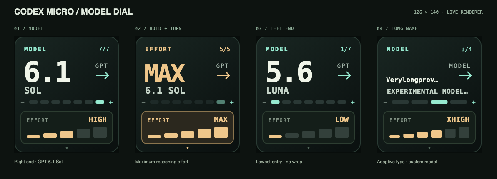

# Configuration

The OpenCodexMicro layout is configured entirely in Ulanzi Studio. Open the
Codex Micro category and drag a keypad action onto a key or an Encoder action
onto a dial position.

Select any configured action to open the shared **Codex Bridge Setup** page.
The page distinguishes the wrapper app installation, Bridge background
service, and Codex CDP connection. It can install or repair the Bridge from
resources bundled with the plugin, launch Codex Bridge, and recheck status.
No repository or npm working directory is required for this flow.

## Actions

| Action | Behavior |
| --- | --- |
| Codex Task 1–5 | Show the matching Most Recent task title and state; press to open it |
| Fast | Toggle Fast mode for the active task |
| Usage | Show remaining usage; press to focus Codex |
| Pin | Pin or unpin the active task |
| New | Create a new Codex task |
| Latest Task & Scroll (Encoder) | Press to open task 1; turn left/right to send mouse-wheel up/down through the Ulanzi hotkey protocol |
| Model & Reasoning (Encoder) | Turn right toward the highest model entry, left toward the lowest; hold and turn right/left to raise/lower reasoning effort; neither list wraps |
| Context Navigator (Encoder) | First turn opens the + / @ menu; turn left/right to move up/down; click to select, hold and turn to close; clicking while closed does nothing |
| Permission Pilot (Encoder) | Turn to change permission policy; for a pending approval select ONCE / CHAT / DENY, then press |
| Fork | Fork the active task |
| Steer | Send the visible composer text as steering input to a running task |
| Mic | Press and release the Codex Micro microphone action |
| Submit | Submit or queue the composer text |

Permission Pilot displays short English policy labels: ASK, REVIEW, FULL,
CUSTOM, PROFILE, or MANAGED, depending on Codex's available options. Turning
stops at either end and skips disabled choices. Normal-mode presses do nothing,
except for the Full access confirmation opened by this dial: the image keeps
showing FULL, press to confirm or turn left to cancel and keep the old policy.
Confirmation is tied to the exact dialog and conversation, and is invalidated
when the dialog closes or the conversation changes.
Other security dialogs cannot be confirmed by the dial. Nothing is confirmed
automatically.

For an approval in the active conversation, ONCE is initially selected; turn
left/right to move between ONCE (allow once), CHAT (allow this conversation),
and DENY. Press once to invoke the corresponding native approval action.
Unavailable choices are greyed out and skipped. A differently scoped action
(for example, allowing all websites or similar commands) is never relabeled
as CHAT. Changing conversations or approval requests resets the selection.
Each press is bound to the displayed conversation and request; stale or
duplicate submissions are rejected. Device layout uses `[0,7,126,126]` and
retains the hardware-required empty text item.

Task actions dynamically use the plugin's idle, working, complete, attention,
error, and offline artwork. Usage is rendered at runtime from the allowance
returned by the Bridge. Latest Task & Scroll mirrors task 1's status artwork.
Latest Task & Scroll and Context Navigator show only a square image in
`[0, 7, 126, 126]`, vertically centered in the 126×140 dial region without
a title. Their layouts retain a hidden, empty
`encoder-label` text item for D200X compatibility.

Task 1–5 show an attention icon and a localized pending-approval or reply-needed
label beside the task title for Codex's `awaiting-approval` and
`awaiting-response` states. Clearing the request restores the current task state;
displaying the state never approves or rejects a request.

Model & Reasoning is a separate dial action. Its 126×140 layout places a PNG
model card in `[0, 7, 126, 126]`, leaving 7px above and below the image.
Keep the empty `model-label` text element: removing it made the tested D200X
display blank. The card emphasizes model version, family and reasoning effort.
Holding the dial highlights reasoning; release returns to model selection.
If approval or a modal temporarily removes the model picker, keep the last model
and effort read for that same conversation, but ignore model/reasoning changes
until the picker is available again. A conversation without a cached selection
never inherits another conversation's model.
Long names are sized to fit. The PNG uses the normal state-image pipeline so
Studio includes it in the device ZIP.
Models run from lightweight families on the left to flagship families on the
right, then by version within each tier. This is a family-based ordering, not
a benchmark ranking; unavailable models are skipped. Reasoning effort increases
from left to right in its supported order. At either end,
rotation leaves the selection unchanged. Switching models keeps the current
effort if supported, otherwise it uses the new model's default. Pressing alone
changes no selection. The action's setup page explains these controls. Update both the
plugin and Bridge for this feature using Install / Repair on the setup page.

Context Navigator is a separate dial action for **Add files and more** (+ / @).
The first detent opens the menu and preserves its initial selection. Subsequent
left/right detents move up/down. A click selects the highlighted entry on release.
Holding and turning either way closes the menu using Escape and suppresses the
confirmation on release. Clicking or holding and turning with the menu closed
neither opens it nor submits composer text.
Menu operations are serialized so fast turns do not repeatedly toggle the menu.
The Bridge targets the active composer's structural attributes, independent of
Codex's display language. Update both the Bridge and plugin for this action.

## Recommended layout

Keep Task 1–5 together in Most Recent order. Place frequently used controls on
the remaining keys; the layout is not hard-coded, and the same action can be
placed on more than one key.

## Runtime requirements

- Start Codex through `~/Applications/Codex Bridge.app`.
- Keep the Bridge sidecar running at `127.0.0.1:17373`.
- Allow Ulanzi Studio under macOS System Settings > Privacy & Security >
  Accessibility so the Encoder can emit mouse-wheel events.
- Restart Ulanzi Studio after installing a new plugin build.

The plugin does not require a separate device service, shortcut file, or theme
configuration. To change shipped artwork, edit the files under
`integration/com.ulanzi.codexmicro.ulanziPlugin/assets/icons/`, rebuild, and
reinstall the plugin.
